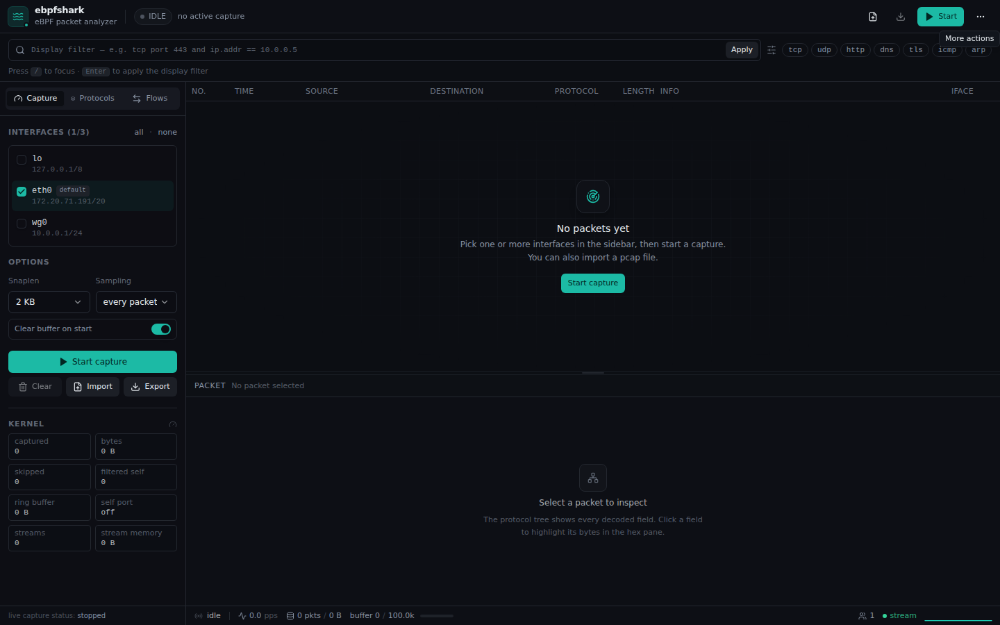

# ebpfshark

> 基于 **eBPF** 的 Linux 抓包与协议分析工具。

ebpfshark 通过 TCX 在 Linux 网卡 ingress/egress 抓包，浏览器中提供实时报文列表、Wireshark 风格协议树和十六进制视图；同时提供 HTTP/SSE API、MCP 和 pcap 导入导出。


## 核心功能

- **实时抓包**：多网卡、ingress + egress、snaplen、采样率；支持 pcap/pcapng 导入导出。
- **浏览器分析**：报文列表、可展开协议树、hex/ASCII、字段高亮、虚拟滚动。
- **显示过滤器**：字段比较、CIDR、端口范围、布尔表达式、`contains`，以及可视化构造器。
- **混合过滤**：安全可下推的 L2–L4 条件编译进 eBPF，应用层字段和复杂表达式继续在用户态精确匹配。
- **TCP 流分析**：乱序/重传/重叠处理、Follow Stream、双向会话统计。
- **AI API 解析**：Anthropic Messages、OpenAI Chat Completions、OpenAI Responses，支持 JSON/SSE。
- **范围抓包**：按进程当前 cgroup、cgroup v2 路径、Pod/容器 cgroup 片段过滤。
- **函数调用追踪（实验）**：CLI、Web 页面和 MCP 均可对显式 `binary:symbol` 挂 uprobe/uretprobe，查看调用耗时。
- **服务化访问**：登录认证、SSE 实时推送、HTTP API、MCP；支持单二进制、Docker 和动态插件。

## 界面预览

| 实时抓包与协议分析 | 显示过滤器与可视化构造器 |
| --- | --- |
|  |  |
| 报文列表、方向、协议树、hex/ASCII 与字段联动。 | 手写表达式（语法高亮、历史记录、协议搜索）或可视化组合条件。 |

| Follow Stream | 更多操作：导入/导出 |
| --- | --- |
|  |  |
| 双向 TCP 会话、乱序/重传处理和流内搜索。 | pcap/pcapng 导入、全量或当前过滤结果导出。 |

## 快速开始

### Docker

```bash
docker build -t ebpfshark:local .

docker run --rm -it \
  --network host \
  --cap-add=BPF --cap-add=NET_ADMIN --cap-add=PERFMON --cap-add=SYS_RESOURCE \
  --security-opt seccomp=unconfined --security-opt apparmor=unconfined \
  --ulimit memlock=-1:-1 \
  -v /sys/kernel/btf/vmlinux:/sys/kernel/btf/vmlinux:ro \
  -e EBPFSHARK_AUTH_PASS='change-this-password' \
  ebpfshark:local -addr 127.0.0.1:9999 -capture eth0
```

Docker 需要 host network、eBPF capability、放宽 seccomp/AppArmor 和 BTF。风险和排障见 **[docs/DOCKER.md](docs/DOCKER.md)**。

### systemd

```bash
sudo ./install.sh
```

安装、服务配置、自动更新和卸载见 **[docs/INSTALL.md](docs/INSTALL.md)**。

### 源码构建

```bash
make build
sudo ./bin/ebpfshark -addr :9999 -capture eth0
```

首次打开 `http://localhost:9999`，使用启动时打印的 `admin` 凭据登录。

## 函数调用追踪

CLI：

```bash
# 检查符号 / build-id / debuginfo
sudo ./bin/ebpfshark trace -pid 1234 -inspect

# 追踪显式函数
sudo ./bin/ebpfshark trace \
  -pid 1234 \
  -func /usr/local/bin/app:main.handler \
  -duration 10s

# 目标即 PID 的 exe 时可以省略 binary
sudo ./bin/ebpfshark trace -pid 1234 -func :main.handler

# 共享库或已知偏移
sudo ./bin/ebpfshark trace -pid 1234 -func /usr/lib/libfoo.so:foo
sudo ./bin/ebpfshark trace -pid 1234 -func /usr/local/bin/app:@0x1234
```

Web 侧栏 **Trace** 标签和 MCP 的 `start_function_trace` / `query_function_trace` 提供同样的能力。`inspect` 可显示 build-id、符号数、debuginfo、容器/Pod cgroup；事件旁边的 `↔` 可查找同一 cgroup、同一时间窗口内的网络包。需要显式符号、带符号 ELF 和 `CAP_BPF`/`CAP_PERFMON`；stripped 二进制会提示安装 debuginfo 或改用地址。

## 常用参数

```text
-capture eth0,lo         启动即抓包的网卡列表
-cgroup pid:1234         只抓指定 cgroup / PID / Pod / 容器
-addr :9999              监听地址
-auth-pass ""            登录密码；留空则随机生成
-max-packets 100000      内存中保留的报文数
-snaplen 2048            每包捕获字节数
-sample-rate 1           每 N 个包抓 1 个
-capture-filter ""       可选显示过滤器；其 L2–L4 子集会在 eBPF 中预过滤
-tls-keylog ""           NSS SSLKEYLOGFILE，用于 TLS 解密
-wifi-psk ""             WPA2-PSK，解密 CCMP/GCMP 无线数据帧
-plugins ""              动态 Go .so 协议插件
```

## 协议支持

默认 **core** 构建包含链路/网络/传输层和常用协议（DNS、DHCP、HTTP/1.x、TLS 等）。使用 `-tags full` 构建完整协议集，包括 HTTP/2、QUIC、MQTT、Redis、PostgreSQL、BGP、SSH、RTP/RTSP、CoAP、Modbus、AMQP、BACnet、OPC UA 等。

完整支持程度、限制和 RFC 参考见 **[docs/PROTOCOLS.md](docs/PROTOCOLS.md)**。

## 已知限制

- 需要 Linux ≥ 6.6、BTF 和 root / `CAP_BPF` + `CAP_NET_ADMIN`。
- 显示过滤器采用混合过滤：L2–L4 安全子集在 eBPF 预过滤，应用层/复杂表达式仍在用户态执行；无法下推的过滤器不会减少内核复制。
- 协议覆盖和深度不及 Wireshark；长期存储/检索不及 Arkime。
- cgroup 抓包要求 cgroup v2；按 PID 实际是解析该 PID 当前 cgroup。
- 函数调用追踪是实验功能，只支持显式符号；已支持基础事件列表、build-id/容器检查和 cgroup 时间窗关联，尚无参数/返回值/USDT。
- Docker 部署会降低隔离；不要暴露 API 到公网，也不要加载不可信插件。

## 文档

| 文档 | 内容 |
| --- | --- |
| [INSTALL](docs/INSTALL.md) | systemd、自动更新、卸载 |
| [DOCKER](docs/DOCKER.md) | Docker/Compose、安全边界和排障 |
| [PROTOCOLS](docs/PROTOCOLS.md) | 协议支持矩阵、RFC、限制 |
| [FILTERS](docs/FILTERS.md) | 过滤语法、字段、构造器 |
| [API](docs/API.md) | HTTP API |
| [MCP](docs/MCP.md) | MCP 工具和客户端配置 |
| [PLUGINS](docs/PLUGINS.md) | 动态 Go 插件 |
| [COMPARISON](docs/COMPARISON.md) | 与 Wireshark / tcpdump 对比 |
| [ARCHITECTURE](docs/ARCHITECTURE.md) | 目录、插件和构建架构 |
| [OPERATIONS](docs/OPERATIONS.md) | 性能、限制和 Roadmap |
| [RELEASE](docs/RELEASE.md) | GoReleaser 和发布 |

## License

MIT
