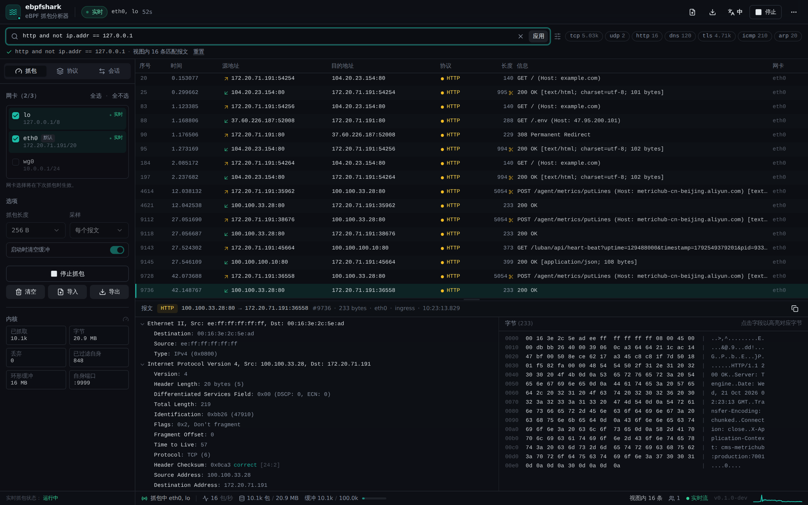
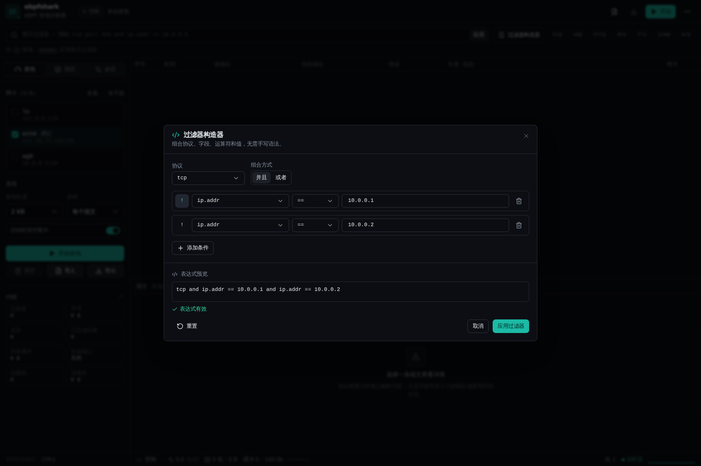
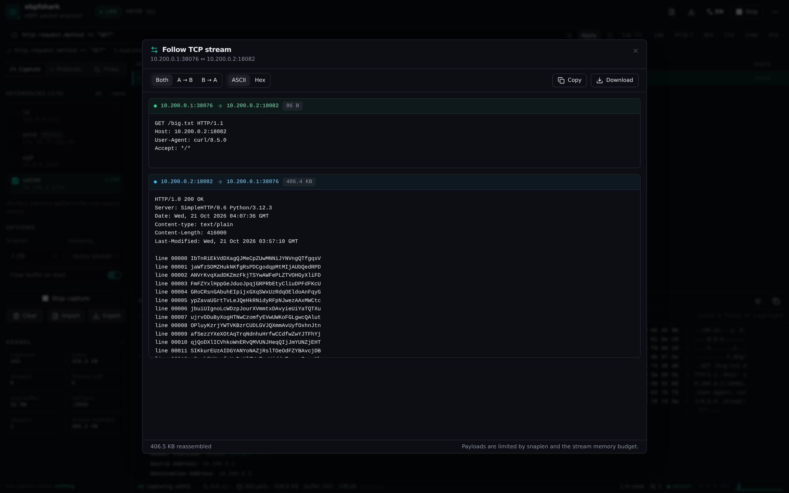
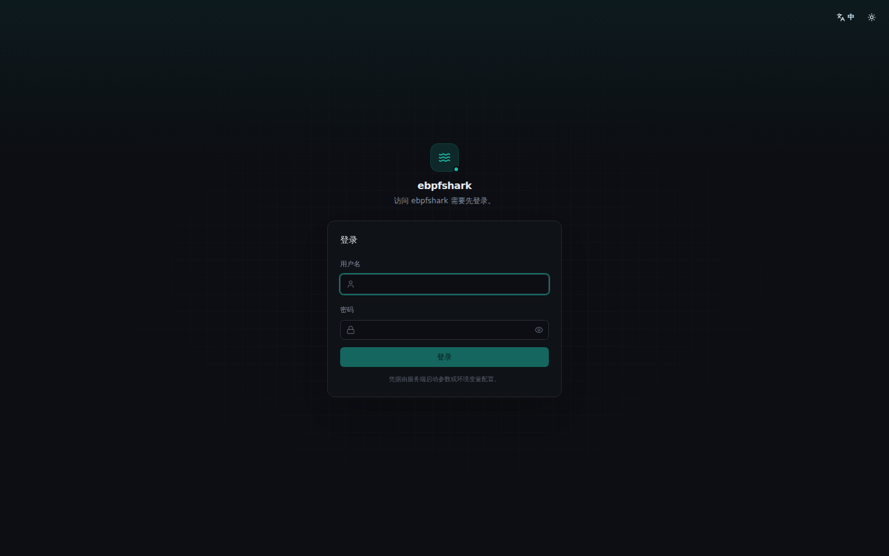

# ebpfshark

> 基于 **eBPF** 的 Linux 抓包与协议分析工具 —— 类似 Wireshark，后端 Go，前端 React + TailwindCSS + shadcn/ui。

ebpfshark 使用 TCX（TC eXpress）把两个很小的 eBPF 程序挂到网卡的 ingress / egress 钩子上，抓到的报文通过 `BPF_MAP_TYPE_RINGBUF` 送到用户态；Go 后端完成协议解析、显示过滤、会话统计与 pcap 导入导出；浏览器端提供实时报文列表、Wireshark 风格协议树和十六进制视图。



## 功能

- **实时抓包**：多网卡、ingress + egress 双向、snaplen 可调（256 B – 2 KB）、按 1/N 采样。
- **内核态统计**：抓包数、字节数、ringbuffer 丢弃数、采样配置全部来自 eBPF map。
- **自动排除自身流量**：在内核态丢弃 HTTP API 端口（默认 `:9999`）的 TCP/UDP 报文，
  避免 UI 轮询/SSE 把分析工具自己的请求混进抓包结果。
- **登录认证**：默认启用用户名/密码登录，HttpOnly 会话 Cookie、登录失败限流；
  除健康检查和登录接口外，所有 API（含 SSE 与 pcap 导出）都要求有效会话。
- **协议解析**：30+ 协议与封装，覆盖链路层、IPv4/IPv6、TCP/UDP、DNS/HTTP/TLS、
  MQTT/Redis/PostgreSQL/BGP/SSH、VXLAN/GRE/MPLS、STUN/NTP/SNMP 等。
  完整列表见 **[协议支持](#协议支持)**。
- **显示过滤器**：Wireshark + tcpdump 混合语法，支持字段比较、CIDR、端口范围、布尔表达式、`contains`。
- **过滤器构造器**：可视化选择协议、字段、运算符和值，支持 AND/OR、取反、实时预览与校验。
- **Wireshark 风格三栏**：报文列表、可展开协议树、hex + ASCII；点击字段高亮对应字节。
- **TCP 流重组 / Follow Stream**：按方向重组 TCP 负载，处理乱序、重传和重叠，支持双向
  ASCII / Hex 查看、复制与下载。
- **MCP 支持**：可作为 Model Context Protocol server（HTTP 或 stdio），让 AI Agent 查询报文、
  启动抓包、追踪 TCP 流。
- **一键安装 / 自动更新**：`install.sh` 生成 systemd 服务与随机凭据；默认每 10 分钟检查
  二进制更新，可通过开关关闭。
- **会话统计**：按双向五元组聚合 TCP/UDP 流量，展示字节数、包数、TCP 状态。
- **文件分析**：导入 `.pcap` / `.pcapng`，导出当前缓冲区或过滤结果为 pcap。
- **开发友好**：单二进制内嵌前端；Vite 开发服务器热更新 + `/api` 代理。
- **中英文界面**：自动检测浏览器语言，也可在右上角 `…` 菜单（登录页在右上角）切换
  `English` / `简体中文`。
- **精简操作栏**：右上角最多保留 5 个常用操作，其余（清空缓冲、主题切换、版本信息）
  收纳到 `…` 菜单。
- **深色 / 浅色主题**、虚拟滚动列表、SSE 实时推送、键盘导航。

## 环境要求

| 组件 | 要求 |
| --- | --- |
| 内核 | **Linux ≥ 6.6**（TCX 需要），启用 BTF：`/sys/kernel/btf/vmlinux` |
| 权限 | root，或 `CAP_BPF` + `CAP_NET_ADMIN` + `CAP_PERFMON` |
| Go | ≥ 1.25 |
| Node.js | ≥ 20，包管理器使用 **pnpm** |
| 从源码构建 eBPF | `clang`、`llvm`（含 `llvm-strip`）、`bpftool`、`libbpf-dev` |

Ubuntu / Debian 安装构建依赖：

```bash
sudo apt-get update
sudo apt-get install -y clang llvm libbpf-dev bpftool
# pnpm（任选其一）
corepack enable
# 或 npm install -g pnpm
```

## 快速开始

### 方式一：一键安装（systemd）

```bash
cd /root/ebpf
sudo ./install.sh
```

脚本会安装到 `/usr/local/bin/ebpfshark`，生成 `/etc/ebpfshark/ebpfshark.env`，创建并启动
`ebpfshark.service`，最后打印登录凭据与 MCP Token。支持 `--port`、`--auth-pass`、
`--mcp-token`、`--update-url`、`--no-auto-update`、`--uninstall` 等参数。

完整说明见 **[docs/INSTALL.md](docs/INSTALL.md)**。

### 方式二：手动构建

```bash
# 1. 生成 eBPF 对象（vmlinux.h + bpf2go，需要 clang/bpftool/libbpf-dev）
make generate

# 2. 构建前端并编译二进制（也可以直接 make build）
make web
make go-build

# 3. 运行（需要 root / CAP_BPF）
sudo ./bin/ebpfshark -addr :9999

# 首次启动会在日志和 stderr 打印随机生成的管理员密码
# 打开 http://localhost:9999，使用 admin + 该密码登录
```

> 仓库不提交 eBPF 生成物。首次从源码构建必须安装 `clang`、`llvm`、`bpftool`
> 和 `libbpf-dev`；`make go-build` 在缺少生成文件时也会自动调用 `make generate`。
> 如果使用一键安装且仓库中没有 `bin/ebpfshark`，同样需要这些构建依赖。

建议通过环境变量设置固定密码（避免每次重启重新生成，也避免密码出现在 `ps` 中）：

```bash
export EBPFSHARK_AUTH_USER=admin
export EBPFSHARK_AUTH_PASS='change-this-password'
sudo -E ./bin/ebpfshark -addr :9999
```

一条命令完成全部构建：

```bash
make build            # generate + web + go-build
sudo ./bin/ebpfshark -addr :9999 -capture eth0
```

启动时自动抓包（可选）：

```bash
sudo ./bin/ebpfshark -capture eth0,lo -snaplen 2048 -sample-rate 1
```

常用参数：

```
-addr :9999              监听地址
-max-packets 100000      内存中保留的报文数（环形缓冲）
-capture eth0,lo         启动即抓包的网卡列表
-snaplen 2048            每包捕获字节数（≤2048）
-sample-rate 1           每 N 个包抓 1 个
-ring-size 33554432      eBPF ringbuffer 大小（字节，默认 32 MiB）
-stream-budget 64        TCP 重组内存预算（MiB）
-exclude-self            排除 HTTP API 端口（默认 true）
-auth-user admin         登录用户名
-auth-pass ""            登录密码；留空则启动时随机生成并打印
-auth-ttl 12h            会话有效期
-secure-cookie           为会话 Cookie 加 Secure（HTTPS 反向代理后使用）
-no-auth                 关闭认证（仅限本机调试，不推荐）
-mcp-token ""            HTTP MCP 的 Bearer Token（留空则启动时生成）
-no-mcp                  关闭 HTTP MCP 端点
-tls-keylog ""           NSS SSLKEYLOGFILE，用于 TLS 1.2/1.3 与 QUIC 解密
-pprof-addr ""           可选本地 profiling 地址，例如 127.0.0.1:6060
-ssh-keys ""             可选 SSH 会话密钥 JSON（仅 AES-CTR）
-wifi-psk ""             可选 WPA2-PSK 口令，解密 CCMP 无线数据帧
-auto-update            自动更新开关（默认 true）
-update-interval 10m    自动更新检查间隔
-update-url ""          自动更新 manifest URL
-web-dir ./web/dist      使用磁盘目录而不是内嵌前端
-log-level info          debug / info / warn / error
```

环境变量：`EBPFSHARK_ADDR`、`EBPFSHARK_MAX_PACKETS`、`EBPFSHARK_IFACE`、`EBPFSHARK_WEB_DIR`、
`EBPFSHARK_LOG_LEVEL`、`EBPFSHARK_AUTH_USER`、`EBPFSHARK_AUTH_PASS`、
`EBPFSHARK_STREAM_BUDGET`、`EBPFSHARK_MCP_TOKEN`、`EBPFSHARK_AUTO_UPDATE`、
`EBPFSHARK_UPDATE_INTERVAL`、`EBPFSHARK_UPDATE_URL`、`EBPFSHARK_TLS_KEYLOG`、`EBPFSHARK_PPROF_ADDR`、`EBPFSHARK_WIFI_PSK`、`EBPFSHARK_SSH_KEYS`。
`SSLKEYLOGFILE` 也会作为 `-tls-keylog` 的默认值。

### 开发模式

```bash
# 终端 1：Go 后端 :9999
make dev

# 终端 2：Vite :5173，/api 代理到 :9999
make dev-web
# 打开 http://localhost:5173
```

### 重新生成 eBPF 代码

修改 `internal/capture/bpf/capture.c` 后：

```bash
make generate   # bpftool 生成 vmlinux.h，bpf2go 生成 capture_bpfel.{go,o}
make go-build        # core：常用协议
make go-build-full   # full：全部协议
```

也可以直接：

```bash
CGO_ENABLED=0 go build -tags full -o bin/ebpfshark ./cmd/ebpfshark
go test -tags full ./...
```

生成物 **不进入 git**：

| 文件 | 处理方式 |
| --- | --- |
| `internal/capture/bpf/vmlinux.h` | 从本机 `/sys/kernel/btf/vmlinux` 生成 |
| `internal/capture/capture_bpfel.go` | bpf2go 生成 |
| `internal/capture/capture_bpfel.o` | bpf2go 生成，由 `//go:embed` 嵌入二进制 |
| `web/dist`、`internal/server/webdist/assets` | 前端构建产物 |
| `bin/`、`web/node_modules/` | 构建/依赖产物 |

因此首次构建请执行 `make build`（或 `make generate`），不要直接运行 `go build ./...`。

## 使用说明

1. 首次打开会进入登录页，使用启动时打印的 `admin` 凭据登录；登录状态由会话 Cookie 保持。
2. 左侧 **Capture** 选择一张或多张网卡（默认自动选中默认路由网卡）。
3. 设置 snaplen、采样率，点击 **Start capture**。
4. 在过滤栏输入显示过滤器，`Enter` 应用；`/` 聚焦输入框，`Esc` 清空。
5. 点击报文查看协议树；点击协议树字段会在右侧 hex 中高亮对应字节。
6. TCP 报文可点击详情栏右上角的 **追踪流 / Follow stream** 按钮查看重组后的双向负载。
7. **Flows** 标签查看双向会话，点击任一会话可直接生成过滤条件。
8. **Export** 导出 pcap；**Import** 载入 pcap/pcapng（会自动停止实时抓包）。
9. 右上角 `…` 菜单中的 **Language / 语言** 切换 `English` / `简体中文`（登录页为右上角
   语言按钮）；首次访问会按浏览器语言自动选择，选择结果保存在 `localStorage`
   （`ebpfshark-locale`）。
10. 右上角最多保留 5 个操作；**语言切换**、**清空缓冲**、**深浅色主题**、**退出登录**和
    版本信息收纳在 `…` 菜单中。
11. 过滤器栏右侧的 **过滤器构造器** 按钮可以可视化组合过滤条件，支持协议、字段、运算符、
    AND/OR、取反、实时预览和校验，应用后自动写入过滤器输入框。

## 协议支持

> 默认 **core** 构建只包含常用协议（DNS、DHCP、HTTP/1.x、TLS、IGMP/MPLS/GRE 及链路/网络/传输层）。完整协议集使用 `-tags full` 或 `make go-build-full`。

> 标注“基础”的协议仍有消息类型/字段待补全，或受加密/压缩限制；加密内容不做解密。

| 层次 | 协议 | 说明 |
| --- | --- | --- |
| 链路层 | Ethernet II | MAC、EtherType |
| 链路层 | 802.1Q / QinQ VLAN | 最多 4 层 VLAN 标签 |
| 链路层 | ARP / RARP | 请求/响应、发送方/目标地址 |
| 链路层 | MPLS | 标签栈、TTL，递归解析内层 IPv4/IPv6 |
| 链路层 | Radiotap / IEEE 802.11 | 无线 monitor 帧、Beacon/Probe/Assoc、SSID/BSSID、RSN/WPA/EAPOL、WPA2-PSK CCMP 解密 |
| 链路层 | Linux SLL / SLL2 | pcap/pcapng 导入的 cooked capture |
| 链路层 | Raw IP | wg/tun 等无二层头接口自动识别 |
| 网络层 | IPv4 | 选项、分片、TTL、校验和 |
| 网络层 | IPv6 | 扩展头、Hop Limit |
| 网络层 | ICMP / ICMPv6 | Echo、不可达、TTL 超时等；ICMPv6 含校验和 |
| 网络层 | IGMP | v1/v2/v3，Query/Report/Leave，完整源列表 |
| 网络层 | GRE | Checksum/Key/Sequence，递归解析 IPv4/IPv6/ARP/以太网 |
| 网络层 | IP-in-IP | IPv4/IPv6 隧道递归解析 |
| 隧道 | VXLAN | VNI + 内层以太网完整解析 |
| 传输层 | TCP | 端口、序列号、标志位、窗口、常用选项、校验和 |
| 传输层 | UDP | 端口、长度、校验和 |
| 传输层 | SCTP | 端口、Verification Tag、DATA/INIT/SACK/HEARTBEAT 等 chunk |
| 传输层 | TLS | 记录层、ClientHello/ServerHello、SNI/ALPN、X.509 证书链、Alert；SSLKEYLOGFILE 解密 TLS 1.3 AES-GCM、TLS 1.2 AES-GCM/CBC |
| 传输层 | QUIC | Long/Short Header、Initial 解密、帧解析、CRYPTO/TLS SNI；HTTP/3 帧 + QPACK 静态/动态表；keylog 解密 Handshake/1-RTT |
| 应用层 | DNS | A/AAAA/CNAME/NS/PTR/MX/TXT/SOA/SRV/CAA/NAPTR/TLSA/SVCB/HTTPS；EDNS0/DNSSEC 标志；mDNS/LLMNR |
| 应用层 | HTTP/1.x | 请求行/状态行、Header、Body 预览 |
| 应用层 | HTTP/2 | 全部帧、HPACK 静态/动态表/Huffman、HEADERS+CONTINUATION、DATA 预览 |
| 应用层 | DHCP | 完整 DHCPv4 消息类型、常用 option、Option Overload、Relay Agent、Classless Routes |
| 应用层 | NTP | 版本、模式、Stratum、时间戳、扩展字段/MAC |
| 应用层 | SNMP v1/v2c/v3 | 全部 PDU、v1 Trap、v2c Bulk、v3 USM 头/Scoped PDU、BER/OID/异常值 |
| 应用层 | Syslog | RFC5424 与 BSD 格式，facility/severity |
| 应用层 | STUN | Binding/Allocate 等方法、ERROR-CODE、XOR-PEER/RELAYED、ICE、Integrity 等属性 |
| 应用层 | MySQL | Handshake、OK/ERR、COM_QUERY/INIT_DB/STMT_PREPARE/EXECUTE |
| 应用层 | RADIUS | Access/Accounting 报文、常用属性、EAP/Message-Authenticator |
| 应用层 | NetFlow / IPFIX | v5 流记录、v9/IPFIX FlowSet/Set 概览 |
| 应用层 | RTP / RTCP | RTP 头、CSRC/扩展、RTCP SR/RR/SDES/BYE/APP |
| 应用层 | WebSocket | Text/Binary/Ping/Pong/Close 帧、掩码、长度 |
| 应用层 | MQTT | 全部 14 种报文、CONNECT/Will/用户名密码、QoS、SUBSCRIBE 选项、v5 Properties |
| 应用层 | Redis | RESP2/RESP3 数组、Map、Set、Push、Double、Bool、BigNum、Verbatim、Blob Error；内联命令 |
| 应用层 | PostgreSQL | Startup/SSL/Cancel、Auth、Query/Parse/Bind、RowDescription/DataRow、Error/Notice、Notify、Copy |
| 应用层 | BGP-4 | OPEN capabilities、UPDATE withdrawn/Path Attributes/NLRI、MP_REACH/UNREACH、Notification/Route-Refresh |
| 应用层 | SSH | 版本标识、KEXINIT 算法列表、KEX、用户认证、Global/Channel 明文消息；加密内容标记 |
| 应用层 | SSDP | M-SEARCH/NOTIFY/响应与常用 Header |
| 应用层 | SIP | 请求/响应、完整 Header、Compact Header、Call-ID/CSeq/From/To、SDP 媒体与属性 |
| 应用层 | WireGuard | 握手 Initiation/Response/Cookie 完整字段、Transport 头部；载荷加密 |

**过滤器**：新增协议同样支持协议谓词，例如 `mqtt`、`redis`、`vxlan`、`bgp`、
`ssh`、`quic`、`http2`、`postgresql`、`mysql`、`radius`、`netflow`、`rtp`、`rtcp`、`websocket`、`sctp`、`wifi`、`radiotap`、`igmp`、`wireguard`。

**尚未支持**：TLS CCM 解密、gRPC/protobuf、LDAP/Kerberos、
完整 NetFlow v9/IPFIX 模板展开、SCTP 分片重组。

## 过滤器构造器



- 入口：过滤器输入框右侧的 **过滤器构造器 / Filter builder** 按钮。
- 可选择一个可选的协议前缀（`tcp`、`http`、`dns` …），再添加多个字段条件。
- 每行支持字段、运算符、值，以及 `!` 取反；行与行之间可切换 **AND / OR**。
- 协议前缀 + OR 条件会自动加括号，例如：
  `tcp and (ip.addr == 10.0.0.1 or ip.addr == 10.0.0.2)`。
- 实时预览表达式，并调用 `/api/filter/validate` 做语法校验；无效时禁止应用。
- 字段目录由后端 `GET /api/filter/schema` 提供，包含类型、可用运算符、枚举值和输入建议。

## TCP 流重组与 Follow Stream



- 按双向 4 元组维护每个 TCP 方向的重组缓冲，按 sequence number 处理乱序、重传和重叠。
- 详情栏右上角 **AlignLeft / 追踪流** 打开；可切换双向 / A→B / B→A，以及 ASCII / Hex。
- 支持复制和下载重组文本；显示已捕获字节数、缺口数量和截断标记。
- 内存预算由 `-stream-budget`（默认 64 MiB）控制，每个方向的上限按预算自动分配
  （256 KiB – 2 MiB）；超出预算时淘汰最久未活跃的流。
- 重组效果取决于 snaplen。默认 2048 B 足以覆盖 MTU 1500 的完整 TCP 负载；如果开启
  较小 snaplen，Follow Stream 会显示缺口或截断。
- TC egress 可能看到 GSO/TSO 超级包（尤其在 veth / loopback 上），单个 skb 超过 snaplen
  时只能捕获头部，重组会出现缺口。需要完整流时建议抓 ingress，或对网卡关闭 GRO/TSO
  （`ethtool -K eth0 gro off tso off`，会降低吞吐）。

## 一键安装与自动更新

- `sudo ./install.sh`：安装二进制、生成 env 与 systemd 服务并启动。
- 自动更新默认开启，每 **10 分钟**检查一次；可用 `--no-auto-update`、
  `-auto-update=false` 或环境变量 `EBPFSHARK_AUTO_UPDATE=false` 关闭。
- 需要在 `EBPFSHARK_UPDATE_URL` 配置 HTTPS manifest（包含 `version` / `url` / `sha256`）；
  未配置时服务正常运行，但自动更新保持 idle。
- 更新会校验 SHA-256 与 ELF 格式，原子替换二进制并重新执行；抓包运行中会跳过本次检查。
- 状态接口：`GET /api/update`（需要登录）。

详细安装、systemd、manifest 发布和回滚说明见 **[docs/INSTALL.md](docs/INSTALL.md)**。

## MCP 支持

ebpfshark 内置 MCP server，支持 **Streamable HTTP** 和 **stdio** 两种传输，提供 12 个工具：

| 工具 | 说明 |
| --- | --- |
| `get_status` | 抓包状态、缓冲/协议/速率统计、流重组统计、网卡列表 |
| `list_interfaces` | 可用网卡及地址、状态、默认路由标记 |
| `start_capture` | 在指定网卡启动抓包（可设置 snaplen / 采样率 / 清空缓冲） |
| `stop_capture` | 停止抓包（保留缓冲数据） |
| `clear_capture` | 清空报文、统计、会话和重组流 |
| `query_packets` | 按显示过滤器返回最近报文摘要 |
| `get_packet` | 返回单条报文的完整协议树，可选 base64 原始字节 |
| `follow_stream` | 返回某条 TCP 报文所属会话的双向重组负载（文本 + 可选 base64） |
| `list_conversations` | 双向会话列表（字节数、包数、TCP 状态） |
| `get_stats` | 缓冲、协议分布、速率、流缓存统计 |
| `validate_filter` | 校验显示过滤器语法 |
| `wait_for_packets` | 等待匹配过滤器的实时报文（带超时） |

### HTTP 传输

```text
POST http://<host>:9999/mcp
Authorization: Bearer <EBPFSHARK_MCP_TOKEN>
```

- 通过 `-mcp-token` 或环境变量 `EBPFSHARK_MCP_TOKEN` 配置 Bearer Token；留空时启动随机生成
  并打印到日志。
- 使用 `-no-mcp` 可完全关闭该端点。
- 端点与 Web 登录会话相互独立，仅校验 Bearer Token；Token 拥有抓包控制与数据读取权限，
  请妥善保管。服务本身不提供 TLS，远程使用请放在 HTTPS 反向代理后。

MCP 客户端配置示例（HTTP）：

```json
{
  "mcpServers": {
    "ebpfshark": {
      "type": "http",
      "url": "http://127.0.0.1:9999/mcp",
      "headers": { "Authorization": "Bearer <token>" }
    }
  }
}
```

手动验证：

```bash
TOKEN='<token>'
curl -s -X POST http://127.0.0.1:9999/mcp \
  -H "Authorization: Bearer $TOKEN" \
  -H 'Content-Type: application/json' \
  -H 'Accept: application/json, text/event-stream' \
  -d '{"jsonrpc":"2.0","id":1,"method":"initialize","params":{"protocolVersion":"2025-06-18","capabilities":{},"clientInfo":{"name":"curl","version":"1"}}}'

curl -s -X POST http://127.0.0.1:9999/mcp \
  -H "Authorization: Bearer $TOKEN" \
  -H 'Content-Type: application/json' \
  -H 'Accept: application/json, text/event-stream' \
  -d '{"jsonrpc":"2.0","id":2,"method":"tools/call","params":{"name":"get_status","arguments":{}}}'
```

### stdio 传输

适合本地 MCP 客户端（Claude Desktop 等）：

```bash
sudo ./bin/ebpfshark mcp
```

stdout 只输出 MCP JSON-RPC，日志写到 stderr。客户端配置示例：

```json
{
  "mcpServers": {
    "ebpfshark": {
      "command": "sudo",
      "args": ["-n", "/root/ebpf/bin/ebpfshark", "mcp"]
    }
  }
}
```

需要抓包时进程必须具备 root 或 `CAP_BPF` / `CAP_NET_ADMIN`；否则 `start_capture` 会返回错误。

## 登录认证



- 认证默认开启。用户名默认 `admin`；密码来自 `-auth-pass` 或 `EBPFSHARK_AUTH_PASS`，
  未设置时每次启动随机生成 24 位密码并打印到日志与 stderr。
- 会话 Cookie `ebpfshark_session`：`HttpOnly` + `SameSite=Lax`，默认有效期 **12h**
  （`-auth-ttl` 可调）。会话保存在进程内存中，**重启服务后需要重新登录**。
- 登录失败 **10 次 / 5 分钟 / IP** 后暂时拒绝登录（HTTP 429），成功登录后清零。
- 除 `/api/health`、`/api/auth/session`、`/api/auth/login`、`/api/auth/logout` 外，
  所有 `/api/*` 都需要有效会话；SSE 流也会在会话过期后的心跳检查中断开。
- 前端静态资源（HTML/JS/CSS）是公开的，但只是登录页外壳；任何抓包数据、统计、
  导出接口都无法匿名访问。
- 服务本身不处理 TLS。公网部署请放在 HTTPS 反向代理后，并使用 `-secure-cookie`，
  或让代理设置 `X-Forwarded-Proto: https`。
- `-no-auth` 会完全关闭认证并打印醒目警告，仅建议在隔离的本机环境使用。
- 密码在内存中以 SHA-256 摘要保存、比较时使用常量时间算法；命令行传参会暴露在
  `ps` 中，生产环境建议使用环境变量。

登录 / 会话 API：

```bash
# 登录（保存 Cookie）
curl -s -c /tmp/ebpfshark.cookie -X POST localhost:9999/api/auth/login \
  -H 'Content-Type: application/json' \
  -d '{"username":"admin","password":"change-this-password"}'

# 之后携带 Cookie 访问受保护 API
curl -s -b /tmp/ebpfshark.cookie localhost:9999/api/status | jq
curl -sN -b /tmp/ebpfshark.cookie 'localhost:9999/api/stream?filter=tcp' | head

# 退出登录
curl -s -b /tmp/ebpfshark.cookie -X POST localhost:9999/api/auth/logout
```

快捷键：

| 按键 | 作用 |
| --- | --- |
| `/` | 聚焦过滤器 |
| `Enter` | 应用过滤器 |
| `Esc` | 清空过滤器 |
| `↑` / `↓` | 切换选中报文 |
| `Home` / `End` | 跳到首条 / 最新一条 |

## 显示过滤器

支持 `and` / `or` / `not`（也可写 `&&` / `||` / `!`）与括号；比较运算支持
`==` `!=` `<` `<=` `>` `>=`（或 `eq` `ne` `lt` `le` `gt` `ge`）以及字符串的 `contains`。

### 协议 / 快捷谓词

| 表达式 | 含义 |
| --- | --- |
| `tcp` `udp` `icmp` `icmpv6` `arp` `ip` `ipv6` | 按协议层匹配 |
| `dns` `http` `tls` `dhcp` `vlan` `eth` | 按应用层 / 链路层匹配 |
| `host 10.0.0.5` | 源或目的 IP |
| `src host 10.0.0.5` / `dst host 10.0.0.5` | 指定方向 |
| `net 10.0.0.0/8` / `net 10.0.0.0 8` | 网段（IPv4/IPv6） |
| `port 443` / `src port 53` / `dst port 53` | 端口 |
| `portrange 8000-8100` | 端口范围 |
| `tcp port 443` | 协议限定的端口（tcpdump 风格） |
| `len > 1000` | 等同 `frame.len > 1000` |

### 字段

| 字段 | 说明 |
| --- | --- |
| `frame.len` `frame.cap_len` `frame.number` `frame.protocols` | 帧长度、捕获长度、序号、协议链 |
| `eth.src` `eth.dst` `eth.type` `vlan.id` | 链路层 |
| `ip.src` `ip.dst` `ip.addr` `ip.proto` `ip.ttl` `ip.len` | IPv4 |
| `ipv6.src` `ipv6.dst` `ipv6.addr` `ipv6.hlim` | IPv6 |
| `tcp.srcport` `tcp.dstport` `tcp.port` `tcp.seq` `tcp.ack` `tcp.window` `tcp.len` | TCP |
| `tcp.flags.syn` `tcp.flags.ack` `tcp.flags.fin` `tcp.flags.rst` `tcp.flags.psh` | TCP 标志位 |
| `udp.srcport` `udp.dstport` `udp.port` `udp.length` | UDP |
| `icmp.type` `icmp.code` `icmpv6.type` | ICMP |
| `arp.opcode` `arp.src.proto_ipv4` `arp.dst.proto_ipv4` | ARP |
| `dns.qry.name` `dns.id` `dns.flags.response` | DNS |
| `http.request.method` `http.request.uri` `http.host` `http.response.code` | HTTP |
| `tls.handshake.type` `tls.handshake.extensions_server_name` | TLS / SNI |

### 示例

```text
tcp port 443 and not arp
http.request.method == "GET" and http.host contains example
dns.qry.name contains github
tls.handshake.extensions_server_name == api.example.com
ip.addr == 10.0.0.0/8 and tcp.flags.syn == 1
(icmp or arp) and frame.len > 64
frame contains "password"
tcp contains "GET /admin"
```

> 过滤器在用户态执行。被过滤掉的包仍然会从内核复制到用户态，因此不会降低抓包开销；
> 高流量场景请使用 snaplen / 采样率控制。

## 架构

```text
┌────────────────────────── Browser ──────────────────────────┐
│  React 18 + TailwindCSS + shadcn/ui (Vite)                  │
│  packet list · protocol tree · hex view · filters · flows   │
└───────────────▲───────────────────────────┬─────────────────┘
                │ REST /api/*               │ SSE /api/stream
┌───────────────┴───────────────────────────▼─────────────────┐
│                       Go backend                            │
│  server ── store (ring buffer, stats, flows, subscribers)   │
│     │        │                                              │
│     │        ├── decode (eth/ip/tcp/udp/dns/http/tls/...)   │
│     │        └── filter (parser + matcher)                  │
│  capture.Manager ── ringbuf.Reader ── TCX links             │
└───────────────────────────▲─────────────────────────────────┘
                            │ BPF ring buffer (16 MiB)
┌───────────────────────────┴─────────────────────────────────┐
│  eBPF: capture_ingress / capture_egress (sched_cls, TCX)    │
│  config map (enabled/snaplen/sample_rate) · per-CPU stats   │
└─────────────────────────────────────────────────────────────┘
```

### eBPF 实现要点

- 使用 `link.AttachTCX` 将两个 `SEC("tc")` 程序挂到每张网卡的 ingress / egress，**无需**
  手动创建 `clsact` qdisc，也不再依赖 `tc` 命令（内核 ≥ 6.6）。
- 每个包写入 ringbuffer 的记录固定预留 `sizeof(hdr) + 2048` 字节（`bpf_ringbuf_reserve`
  的 size 必须是编译期常量），实际长度记录在 `caplen` 字段，用户态按 `caplen` 截取。
- `config` array map 保存 `enabled` / `snaplen` / `sample_rate`；采样使用 per-CPU 计数器，
  避免 fast path 上的原子操作。
- `stats` per-CPU array map 记录抓包数、字节数、ringbuffer 预留失败次数。
- 时间戳使用 `bpf_ktime_get_ns()`（`CLOCK_MONOTONIC`），用户态用启动时的
  `CLOCK_MONOTONIC` / wall-clock 偏移换算成绝对时间。
- 内核态解析 IPv4/IPv6 + TCP/UDP 头（含最多 4 层 VLAN）并按端口丢弃自身 API 流量，
  计入 `filtered` 计数；可用 `-exclude-self=false` 关闭。
- 所有协议解析都在用户态完成，因此修改解析逻辑不需要重新编译/加载 eBPF。

### 目录结构

```
cmd/ebpfshark/              main：flag、信号处理、HTTP server
internal/capture/           eBPF 加载、TCX 挂载、ringbuf 读取、网卡枚举
  bpf/capture.c             抓包 eBPF C 代码
  bpf/vmlinux.h             bpftool 生成（本地生成，不提交）
  capture_bpfel.{go,o}      bpf2go 生成（本地生成，不提交）
internal/decode/            30+ 协议解析（Ethernet/IP/TCP/UDP/应用层/隧道）
internal/filter/            显示过滤器 lexer/parser/matcher + 构造器 schema
internal/auth/              密码校验、内存会话、登录限流
internal/store/             报文环形缓冲、统计、会话、SSE 订阅者
internal/stream/            TCP 流重组（乱序/重传/缺口）
internal/mcpserver/         MCP 工具（HTTP + stdio）
internal/update/            自动更新（manifest/SHA-256/原子替换）
internal/pcapio/            pcap / pcapng 读写
internal/server/            REST + SSE + 内嵌前端
web/                        React + Vite + Tailwind + shadcn/ui
  src/i18n/                 中英文文案与语言切换（localStorage 持久化）
```

## HTTP API

除登录相关接口外，以下 API 均**需要登录会话**。

| 方法 | 路径 | 说明 |
| --- | --- | --- |
| GET | `/api/auth/session` | 当前会话状态（公开） |
| POST | `/api/auth/login` | 登录，设置会话 Cookie（公开） |
| POST | `/api/auth/logout` | 退出登录 |
| GET | `/api/health` | 健康检查（公开） |
| GET | `/api/status` | 抓包状态、统计、网卡列表 |
| GET | `/api/interfaces` | 网卡列表 |
| POST | `/api/capture/start` | `{interfaces, snaplen, sampleRate, clear}` |
| POST | `/api/capture/stop` | 停止抓包 |
| POST | `/api/capture/clear` | 清空缓冲区 |
| GET | `/api/packets?filter=&limit=` | 最近 N 条匹配报文 |
| GET | `/api/packets/{id}` | 协议树 + base64 原始字节 |
| GET | `/api/packets/{id}/stream` | 该 TCP 报文所属会话的双向重组负载 |
| GET | `/api/stream?filter=` | SSE：`packets` / `ready` 事件 |
| GET | `/api/stats` | 计数器、协议分布、60 秒速率 |
| GET | `/api/conversations?limit=` | 双向会话 |
| POST | `/api/filter/validate` | `{filter}` → `{valid, error}` |
| GET | `/api/filter/fields` | 可过滤字段（用于补全） |
| GET | `/api/filter/schema` | 过滤器构造器字段目录（类型/运算符/枚举值） |
| GET | `/api/update` | 自动更新状态 |
| GET | `/api/export/pcap?filter=` | 导出 pcap |
| POST | `/api/import` | multipart `file` 导入 pcap/pcapng |

示例：

```bash
# 先登录拿到 Cookie（见上一节），然后：
curl -s -b /tmp/ebpfshark.cookie localhost:9999/api/status | jq
curl -s -b /tmp/ebpfshark.cookie -X POST localhost:9999/api/capture/start \
  -H 'Content-Type: application/json' \
  -d '{"interfaces":["eth0"],"snaplen":2048,"clear":true}'
curl -s -b /tmp/ebpfshark.cookie \
  'localhost:9999/api/packets?filter=tcp%20port%20443&limit=5' | jq
curl -sN -b /tmp/ebpfshark.cookie 'localhost:9999/api/stream?filter=http' | head
curl -s -b /tmp/ebpfshark.cookie \
  'localhost:9999/api/export/pcap?filter=dns' -o dns.pcap
```

## 性能与资源

基准与 profiling 方法见 **[docs/PERF.md](docs/PERF.md)**。

- ringbuffer 默认 32 MiB；报文缓冲默认 100,000 条（`-max-packets`）；TCP 重组默认
  64 MiB 预算（`-stream-budget`）。按 snaplen 2048 B 估算，总内存约 150–250 MB。
- 每条报文在 Go 侧做一次协议解析，SSE 每 50 ms 批量推送（最多 512 条/批）。
- 前端列表使用虚拟滚动，最多保留 20,000 条；更早的报文仍可在后端导出。
- 订阅者消费过慢时会丢弃并计入 `dropped`，不会阻塞抓包线程。
- 协议层判断使用 `LayerMask` 位图，避免每个包反复扫描 `[]string`。
- 入包使用 `DecodeSummary`：只生成 Summary/Meta，不构建详情字段树；详情页按需 `Decode`。
- 有 keylog 时 TLS/QUIC 应用数据解密也延迟到详情页，列表路径不做无效解密。
- 详情字段树使用对象池，减少反复点击详情的 GC 压力。
- 十六进制预览改为查表输出，避免逐字节 `fmt.Fprintf`。
- 相同过滤表达式的多个 SSE 订阅者只计算一次过滤结果。
- flow 统计使用结构体 key，不再每包拼接 IP/端口字符串；flow 锁与 ring buffer 锁分离。
- 详情字段树有 256 条 / 32 MiB LRU 缓存，避免重复点击重复解码。
- SSE 批量 JSON 复用 buffer，减少 map/临时分配。
- TCP 重组改为 owned chunk 列表，避免大流反复扩容拷贝。
- X.509 证书按 DER SHA-256 缓存，重复证书不重复解析。
- TLS/HTTP2 per-flow 状态有上限；流量表/重组表超限时批量淘汰，避免每包 O(n) 扫描。

## 已知限制

- TCP 流重组只处理已捕获的字节：snaplen 截断、GSO/TSO 超级包、内核丢包都会表现为缺口；
  重组不做应用层协议解析（HTTP body 分块、gzip/br 解压等仍需后续处理）。
- 未提供 keylog 时不解密 TLS/QUIC 应用数据；只能看到握手/记录层字段。
- snaplen ≤ 2048 B；超出部分标记为 truncated（列表中的 ✂）。
- 过滤器在用户态执行，不具备内核级过滤的性能优势。
- TCX 需要内核 ≥ 6.6 且启用 BTF；旧内核暂不支持。
- 隧道网卡（wg/tun）上没有二层头，解析器会自动识别裸 IP。
- 无线 monitor 接口按 `ARPHRD_IEEE80211` / `ARPHRD_IEEE80211_RADIOTAP` 选择链路类型；VLAN 子接口会作为普通接口列出，可直接选择抓包。
- 无线支持 WPA2-PSK/CCMP 解密：需要 `-wifi-psk`、SSID Beacon/Probe Response、完整 4-way 握手。
  WPA/WPA3、GCMP、TKIP、分片重组尚未解密；Radiotap 只展开标准字段。
- 同时在 ingress/egress 抓同一个包会在 loopback 上看到重复记录（两个钩子各一次）。
- 只有单用户认证，没有角色/多用户权限；会话存于内存，服务重启后失效。
- 不内置 TLS；公网访问请使用 HTTPS 反向代理并启用 `-secure-cookie`。
- 登录限流按 TCP 源 IP 统计；在反向代理后请确保代理正确传递客户端地址，否则所有
  用户会共享同一个限流计数。

### 协议解析已知问题

- **MQTT**：v4/v5 的 Properties 主要依据报文内“非空属性长度 + 已知属性 ID”启发式识别，
  未按连接持久化协议版本；v5 空 Properties 不会自动识别，会作为载荷显示。
- **PostgreSQL**：`'D'`（DataRow/Describe）、`'E'`（ErrorResponse/Execute）、
  `'S'`（ParameterStatus/Sync）在前端与后端含义不同，当前按报文结构启发式区分；
  SASL 认证只展开消息类型，不解析 SASL 机制载荷。
- **BGP**：AS_PATH 的 2/4 字节 ASN 依据属性长度推断；未根据 Add-Path capability
  自动启用 Path ID；MP_REACH 只展开基础 next-hop/NLRI，未做完整 VPN/EVPN 解析。
- **SNMP v3**：只解析明文 Scoped PDU；加密 PDU 仅显示密文；USM 认证/加密参数
  只展示，不校验认证码，也不解密 privacy。
- **SIP**：一个 TCP 段按一条 SIP 消息解析，未做多消息边界/流水线重组；SDP 只展开
  常用字段，不解析完整 SDP 协商；multipart body 未展开。
- **SSH**：密钥交换后的包为加密载荷，只能显示长度与密文；`31/32/33/34` 在不同
  KEX 方法中含义重叠，按载荷结构启发式区分。
- **Redis**：RESP3 的 chunked string（`;`）与 attribute（`|`）只做有限展开；
  顶层 reply 与命令的区分依赖已知命令表。
- **DNS/DHCP**：DNS 未覆盖全部 RR 类型；DHCP 未实现全部 255 个 option。
- **TLS 解密**：需要启动时通过 `-tls-keylog` / `SSLKEYLOGFILE` 提供密钥；TLS 1.3
  支持 AES-128/256-GCM 与 ChaCha20-Poly1305，TLS 1.2 支持 AES-GCM、AES-CBC 与
  ChaCha20-Poly1305；CCM 套件暂不解密。
  若抓包从握手中间开始，缺少 ClientHello/ServerHello/序列号状态时只能显示密文。
- **TLS 证书**：只做 X.509 解析，不做证书链信任校验；证书消息必须完整捕获，
  snaplen 截断时只能显示部分 DER。
- **HTTP/2 HPACK**：动态表按 TCP 流保存在有上限的 flow store 中；HEADERS 与
  CONTINUATION 支持跨 TCP 段合并；从连接中间开始抓包时仍可能缺少动态表上下文。
- **QUIC**：Initial 使用 RFC 9001 v1/v2 固定盐解密；Handshake/1-RTT 需要 keylog 且
  必须先捕获 ClientHello。Short Header 默认按 8 字节 DCID 解析。HTTP/3 帧与 QPACK
  静态/动态表已支持；动态表依赖先捕获 Encoder stream，跨连接迁移或抓包不完整时
  动态索引可能显示为占位符。
- **SSH**：仍只解析明文消息；加密后的 KEX/用户认证/通道数据无法解密，未实现
  SSH 私钥导入。

## Roadmap

- [ ] 内核态预过滤（把常用显示过滤器编译成 cBPF/eBPF）
- [x] HTTP/2 HPACK、QUIC Initial/keylog、HTTP/3 + QPACK 静态/动态表
- [ ] 抓包文件分片、时间范围导出
- [ ] 报文着色规则与自定义列
- [ ] Prometheus metrics / OpenTelemetry 导出
- [ ] 多用户 / 角色权限、审计日志
- [ ] 内置 TLS 与 OIDC / LDAP 登录

## License

MIT
