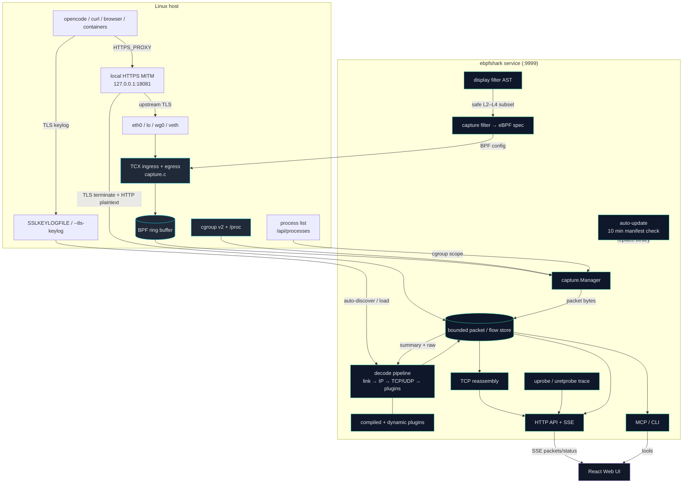

# Architecture

## Decode pipeline

```
capture -> store -> decode.DecodeSummary -> packet list
                               |
                               +-> decode.Decode (detail, on demand)
```

The default build is **core** (DNS/DHCP/HTTP/TLS). `-tags full` adds every
protocol plugin. Link-layer, IP, transport and tunnel decoders are always
present because they define packet metadata and filtering.

## Application plugins

Application dissectors do not live in one switch/chain file. Each protocol
module registers a `pluginSpec` in `init()`:

```go
func init() {
    RegisterPlugin(pluginSpec{
        Name:      "example",
        Priority:  100,
        Transport: TransportTCP | TransportUDP,
        Match:     func(c *ctx, sport, dport uint16, b []byte) bool { ... },
        Dissect:   func(c *ctx, b []byte, base int) bool { ... },
        Display:   "Example", // optional summary name
    })
}
```

`plugin.go` collects registrations, sorts by priority, and exposes immutable
chains per transport. `dispatch.go` is the only transport-to-plugin entry
point. `Match` must be cheap and must not mutate the context; `Dissect`
returns `true` only when it claims the payload.

Rules:

- Keep protocol-specific code and helpers in `proto_<name>.go`.
- Put `//go:build full` on non-default plugins.
- Use priorities to preserve protocol precedence, not registration order.
- Register both transport directions in one spec where possible.
- Decrypted TLS/QUIC/SSH payload dispatch uses `Decrypted: true`; such
  plugins run without ports.
- Compiled-in plugins register during init. The dynamic loader may append before capture starts; the versioned cache rebuilds the chains on the next decode.

## Runtime plugins

Compiled-in plugins and dynamic `.so` plugins share the same registry. A
dynamic plugin exports `Plugin` or `New` using `ebpfshark/pkg/pluginapi`;
`LoadDynamicPlugins` adapts it into a `pluginSpec` and bumps the registry
version so the next decode rebuilds the chains.

Dynamic loading is optional: it requires cgo and is not available on Windows.
The release/static builds remain self-contained. See
[docs/PLUGINS.md](PLUGINS.md) for the ABI, build command and security model.

## Core vs full

| Build | Selected by | Plugin files |
| --- | --- | --- |
| core | default | `proto_dns.go`, `proto_http.go`, `proto_tls.go`, `app_dhcp.go` |
| full | `-tags full` | all `proto_*.go` with the `full` tag |

`go test ./...` exercises core; `go test -tags full ./...` exercises all
plugins. CI does both, plus race, fuzz and benchmark smoke.

## Package layout

```
cmd/ebpfshark        flags, startup, doc
internal/capture     eBPF/pcap capture
internal/decode      link/IP/transport + application plugins
internal/instrument  instrumentation contracts (targets, events, backend)
internal/instrument/target  ELF/build-id/symbol/PID/cgroup discovery
internal/probe       uprobe/uretprobe instrumentation backend
internal/trace       trace session lifecycle and bounded event history
pkg/pluginapi        stable ABI for runtime .so plugins
internal/filter      filter language, schema
internal/packet      Meta/Summary/LayerMask/Field-independent packet types
internal/store       bounded packet/flow stores
internal/server      HTTP/SSE API
internal/mcpserver   MCP tools over the same store
web/                 React UI
```

## Adding a protocol

1. Add `internal/decode/proto_example.go` with `//go:build full`.
2. Implement `dissectExample`.
3. Register matcher + dissector in `init()`.
4. Add the layer name to `internal/packet/packet.go`.
5. Add core/full filter schema names in `internal/filter/schema_layers_*.go`
   and a predicate in `internal/filter/filter.go` if it is a layer.
6. Add a focused decode test and update `plugin_full_test.go` expectations.
7. Update the README support matrix: support level, limitations and primary RFC/standard.

## Instrumentation boundary

Function tracing is split so the API/UI never depend on uprobe internals:

```text
internal/instrument        Target / Event / Session / Backend
        ^                         ^
        |                         |
internal/instrument/target   internal/probe
ELF + symbol discovery       uprobe + uretprobe backend
        ^                         ^
        +-------- internal/trace -+
                  session/history/query
                         ^
                server / MCP / CLI
```

`trace.Manager` owns session lifecycle and queries. It accepts an
`instrument.Backend`; `probe.Backend` is the current uprobe adapter. Adding
USDT, DWARF arguments, or a fake backend does not require changing the HTTP or
MCP layers.

## Current system diagram


